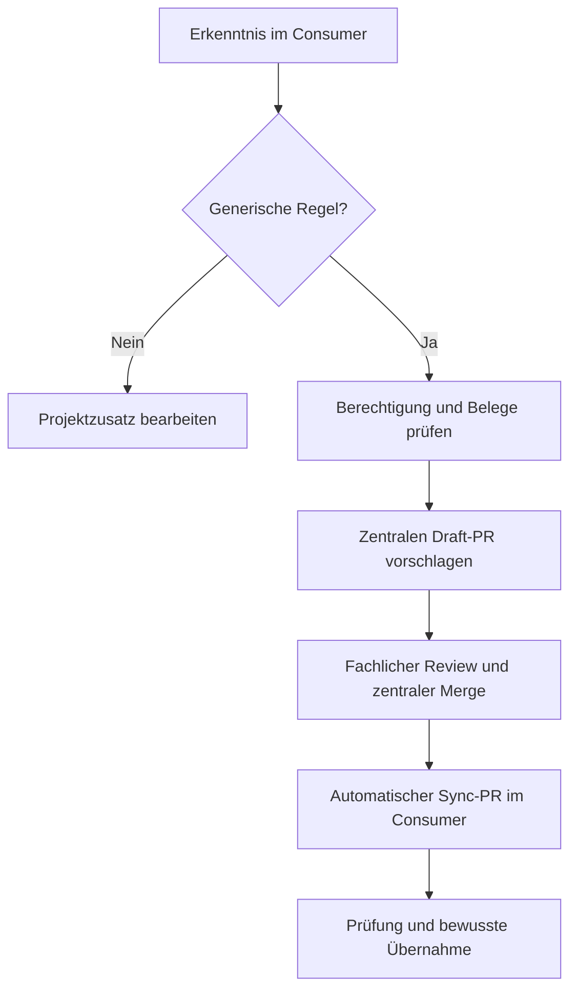

# FHEM Agent Rules

Dieses Repository verwaltet gemeinsame Arbeitsanweisungen für Coding-Agenten, die
an mehreren FHEM-Modulen arbeiten. Es verbindet **eine zentral gepflegte Regelquelle**
mit **reproduzierbaren lokalen Kopien**, projektspezifischen Zusätzen und einer
prüfbaren Verteilung über Pull Requests. Es enthält kein installierbares FHEM-Modul.

Die maßgebliche generische Regeldatei ist [AGENTS.md](AGENTS.md). Angeschlossene
Modul-Repositories übernehmen sie unverändert und dokumentieren den übernommenen
Commit. Ihre eigenen Anforderungen bleiben in einem `AGENTS-<Projekt>.md`-Zusatz.
Für Arbeiten an der zentralen Quelle zusätzlich [AGENTS-RULES.md](AGENTS-RULES.md) lesen.

## Ziel und Abgrenzung

Bei unabhängig gepflegten Regeldateien können gemeinsame Erkenntnisse verloren gehen
oder widersprüchlich werden. Diese Lösung gibt generischen Regeln einen eindeutigen
Pflegeort, ohne die Agenten bei jeder Aufgabe von einem dynamischen Download der
neuesten Anweisungen abhängig zu machen.

Generisch sind beispielsweise belegte FHEM-Framework-Verträge, Regeln zur Quellenprüfung,
Testaussagekraft oder zum Umgang mit Persistenz. Konkrete Gerätebefehle, Moduldateien,
Produktentscheidungen und individuelle Migrationsanforderungen bleiben projektspezifisch.
Die Trennung wird fachlich überprüft; ein Bytevergleich kann sie nicht selbst entscheiden.

Eine zentrale Quelle bedeutet hier **einen Pflegeort**, nicht eine einzige physische
Datei. Die lokalen Kopien sind bewusst versioniert. Eine Änderung der zentralen Quelle
ändert weder sofort die Regeln eines laufenden Arbeitsbranches noch beliebige ältere
Checkouts. Bis zur bewussten Übernahme gilt die dokumentierte akzeptierte Revision.

## Architektur und Zuständigkeiten

| Bestandteil | Zuständigkeit |
| --- | --- |
| Zentrale `AGENTS.md` | Gemeinsame Regeln und Wartungsablauf; hier werden generische Änderungen vorgeschlagen |
| Zentrale `AGENTS-RULES.md` | Anforderungen an die Pflege der Regeln und des Synchronisationswerkzeugs |
| Lokale `AGENTS.md` im Consumer | Unveränderte Kopie einer akzeptierten zentralen Revision |
| Lokale `AGENTS-<Projekt>.md` | Projektspezifische Vorgaben, die zusammen mit der generischen Datei gelesen werden |
| Lokale `.github/agent-rules.json` | Herkunftsrevision und Name des Projektzusatzes |
| Consumer-Prüfung | Prüft Herkunft, akzeptierte Revision, Zusatz und Bytegleichheit; verändert keine Projektdatei |
| Zentraler Verteiler | Erstellt bzw. aktualisiert Draft-PRs mit Regeln und Herkunftsdatei |
| Maintainer | Entscheidet über fachliche Regeln und die Übernahme der zentralen und lokalen PRs |

Die GitHub App dient dem zentralen Workflow zur Authentifizierung. Sie ist kein
Coding-Agent, benötigt keinen eigenen laufenden Server und verleiht einem Agenten
im Consumer nicht automatisch Zugang zum zentralen Repository. Prüfungen in
Consumer-PRs erhalten keine Verteilungszugangsdaten.

## Aufbau

- `AGENTS.md`: gemeinsame Regeln einschließlich des Rückwegs für neue Erkenntnisse.
- `AGENTS-RULES.md`: Pflege- und Tooling-Anweisungen für dieses Repository.
- `consumers.json`: ausdrückliche Liste angeschlossener Projekte und ihrer Zusätze.
- `scripts/agent_rules.py`: Prüfung und Verteilung, nur Python-Standardbibliothek und Git.
- `.github/workflows/check-consumer.yml`: wiederverwendbare, lesende Projektprüfung.
- `.github/workflows/distribute.yml`: Verteilung über Draft-PRs, anfangs deaktiviert.

Eine Projektdatei `.github/agent-rules.json` enthält `schema: 1`, unter `source`
das feste Repository `Flachzange/FHEM_Agent_Rules`, den Pfad `AGENTS.md` und einen
vollständigen Commit-SHA sowie unter `supplement` den registrierten Projektzusatz.
Die eigentliche `AGENTS.md` bleibt bytegleich; Herkunftsinformationen stehen separat.

## Rückweg für neue Erkenntnisse

1. Zunächst den Geltungsbereich und die Berechtigung der aktuellen Aufgabe prüfen.
   Projektspezifische Vorgaben im Projektzusatz bearbeiten.
2. Übertragbare Erkenntnisse als zentralen Draft-PR vorschlagen: Ursprung verlinken,
   Belege, Geltungsbereich und Grenzen beschreiben sowie vorhandene Regeln auf
   Dopplungen und Widersprüche prüfen. Bestehende Bearbeitungsberechtigungen beachten.
3. Maintainer prüft die fachliche Eignung. Keine automatische semantische Freigabe.
4. Nach zentralem Merge verteilt die Automatik die neue Fassung über Projekt-PRs.



Der Rückweg ist eine Arbeitsanweisung für Agenten und Maintainer. Die Automatik
erzeugt aus einer lokalen Ergänzung weder selbstständig eine fachlich bewertete Regel
noch einen zentralen PR. Fehlen dem Agenten Zugriff oder Autorisierung, muss er einen
konkreten Änderungsvorschlag sichern und die Einschränkung benennen. Eine Client-Aufgabe
ist keine pauschale Freigabe zur Bearbeitung weiterer Repositories oder zum Mergen.

Während einer laufenden Implementierung kann unabhängige Arbeit weitergehen. Ein
Konflikt mit einer bestehenden Regel muss vor einer davon abhängigen Umsetzung
ausdrücklich geklärt werden. Nach zentraler Annahme muss die benötigte Revision bewusst
in den Arbeitsbranch übernommen werden: Der Verteiler pflegt seinen eigenen
Synchronisierungsbranch und aktualisiert keine beliebigen Featurebranches.

Lokale generische Änderungen lassen den Projektcheck fehlschlagen. Der Check
überschreibt nichts. Ein abweichender Text wird als Patch im Workflow-Artefakt
`agent-rules-upstream-proposal` für 14 Tage bereitgestellt; der Projektbranch bleibt
ebenfalls die ursprüngliche Quelle. Der Patch wird nicht automatisch zentral
angewendet. Er dient als Grundlage des belegten zentralen Vorschlags.

## Prüfung und reproduzierbare Übernahme

Der Projektcheck prüft die Herkunft, den vollständigen SHA, dessen Erreichbarkeit
von zentraler `main`, den vorhandenen registrierten Zusatz und die Bytegleichheit.
Unbekannte oder nicht gemergte Revisionen und lokale Sonderfassungen werden abgewiesen.
Er prüft keine inhaltliche Widerspruchsfreiheit beliebiger Projektzusätze.

Der Workflow selbst und sein `tooling-ref` werden auf denselben geprüften zentralen
Commit gepinnt. Dieser Tooling-Pin bleibt bei gewöhnlichen Regelupdates unverändert;
die Herkunftsdatei kann spätere akzeptierte Regelrevisionen übernehmen. Neuer Checker-Code
wird in einem gesonderten Projekt-PR übernommen, nicht bei jeder Textänderung mit ausgeführt.
Bei neuen Verbrauchern muss deren Registrierung auch in der übernommenen Tooling-Version
vorliegen. Die beiden Pilotprojekte sind bereits registriert.

Den tatsächlich angezeigten GitHub-Statuscheck des wiederverwendbaren Jobs
`agent-rules` in beiden Projekten als erforderlich einrichten. Die genaue Anzeige
kann den aufrufenden Jobnamen enthalten. Das ist eine Repository-Einstellung:
eine Workflow-Datei allein verhindert noch keinen Merge. Direkte Umgehungen der
Branch-Regel müssen ebenfalls passend eingeschränkt werden.

Feste Revisionen garantieren Konsistenz und Nachvollziehbarkeit, nicht sofortige
Aktualität: bis zum Merge eines Synchronisierungs-PRs gilt die ausgewiesene alte Fassung.
Bei einem Fehler beim Abruf schlägt der Check fehl; er behauptet dann keine Übereinstimmung.

## Initiale Einrichtung und Reihenfolge

1. Zentrale Implementierung prüfen und zuerst mergen.
2. Die vorgeschlagene Herkunftsrevision muss Bestandteil der zentralen `main`-Historie
   sein. Nach einem normalen Merge kann der ursprüngliche Commit weiterverwendet werden;
   dann genügt bei zuvor roten Checks ein erneuter Lauf. Nach Squash-/Rebase-Merge
   kann eine Aktualisierung auf den tatsächlich übernommenen Commit nötig sein.
   Workflow-Referenz und `tooling-ref` bei der ersten Anbindung auf einen geprüften
   zentralen Tooling-Stand setzen. Nicht akzeptierte Herkunftsrevisionen werden abgewiesen.
3. Beide Projekt-PRs prüfen/mergen und den Statuscheck als erforderlich konfigurieren.
4. GitHub App und zentrale Variablen/Secret einrichten, anschließend Verteilung aktivieren.
5. Ersten Live-Abgleich prüfen. Einen erfolgreichen Lauf ohne Änderungen vom
   tatsächlichen Erstellen und Aktualisieren eines Sync-PRs unterscheiden.

## GitHub App und Verteilung

Eine eigene App auf die drei beteiligten Repositories begrenzen. Für normale
Synchronisierung benötigt sie `Contents: read and write`, `Pull requests: read and write`
und die von GitHub bereitgestellten Metadaten-Leserechte. Keine Administration oder
Workflow-Schreibrechte erforderlich: der Verteiler verändert keine Workflow-Dateien.

Nur im zentralen Repository konfigurieren:

| Typ | Name | Wert |
| --- | --- | --- |
| Variable | `AGENT_RULES_APP_ID` | ID der eigenen GitHub App |
| Secret | `AGENT_RULES_APP_PRIVATE_KEY` | Vollständiger privater App-Schlüssel |
| Variable | `AGENT_RULES_SYNC_ENABLED` | Erst nach abgeschlossener Einrichtung `true` |

Zugangsdaten nicht in Chat, Dateien oder PR-Beschreibungen kopieren. Ohne aktivierende
Variable wird der Verteilungsjob übersprungen. Das ist ausdrücklich kein erfolgreicher Live-Test.

Der zentrale Workflow startet nach passenden `main`-Änderungen, täglich um 06:23 UTC
als Nachholprüfung und manuell über GitHub Actions. Er arbeitet immer auf zentraler
`main`. Er prüft jedes Projekt zunächst lesend und wendet nur einen gültigen Plan an.
`consumers.json` und die Repository-Liste der Token-Erstellung im Workflow müssen
bei der Aufnahme weiterer Projekte gemeinsam aktualisiert werden.

Pro Projekt wird `codex/sync-agent-rules` verwendet. Der Verteiler erstellt höchstens
einen offenen Draft-PR, aktualisiert ihn bei weiteren Revisionen und schreibt bei
bereits passendem Inhalt keinen neuen Commit. Er schreibt nur `AGENTS.md` und
`.github/agent-rules.json`, nie direkt auf Projekt-`main`, und mergt/force-pusht nicht.
Ältere bereits gültige Manifestrevisionen bleiben erhalten, wenn sich nur zentrale
Werkzeuge oder Dokumentation und nicht die generischen Regeln geändert haben.

Abweichende Default-Branch-Dateien oder handbearbeitete/unabhängig erweiterte
Synchronisierungsbranches werden nicht überschrieben. Der Lauf meldet den Konflikt.
Das betroffene Projekt muss erst geprüft werden; andere registrierte Projekte können
weiterlaufen. Ein paralleler Branchfortschritt kann die nicht erzwungene Aktualisierung
ablehnen. In diesem Fall nach Prüfung erneut ausführen.

## Lokale Prüfungen

Aus dem zentralen Checkout:

```bash
bash scripts/ci.sh
```

Für einen daneben ausgecheckten WIFFI-Pilot gilt nach Abruf der zentralen `main`-Historie:

```bash
git fetch origin main:refs/remotes/origin/main
python3 scripts/agent_rules.py check --central-root . --project-root ../FHEM_Modul_Wiffi --repository Flachzange/FHEM_Modul_Wiffi --diff-output agent-rules-upstream.patch
```

Mit bereits sicher gesetztem `GH_TOKEN` kann zunächst ohne Schreibvorgang geplant werden:

```bash
python3 scripts/agent_rules.py sync --central-root .
```

Die Schreibvariante ist im vertrauenswürdigen zentralen Workflow hinterlegt.
Unit-Tests verwenden echte temporäre Git-Historien und einen zustandsbehafteten
GitHub-API-Testdouble. Sie belegen Auswahl, Ablehnungen, Dateiumfang und Idempotenz,
aber keine realen App-Schreibrechte oder Branch-Regeln. Ein erfolgreicher Live-Abgleich
ohne Änderungen bestätigt Authentifizierung und Lesezugriff; er belegt noch keinen
erfolgreichen Schreibvorgang für einen Synchronisierungs-PR.

## Bewusste Grenzen

- Die Prüfung erkennt lokale Textabweichungen, aber keine inhaltlich falsche generische
  Regel und keinen semantischen Widerspruch in einem beliebigen Projektzusatz.
- Akzeptierte ältere Revisionen bleiben gültig. Aktualität entsteht durch die Übernahme
  von Update-PRs, nicht durch einen automatischen Wechsel der Regeln während einer Aufgabe.
- Der CI-Job kann erst durch erforderliche Statuschecks und passende Branch-Regeln
  einen Merge blockieren. Die Workflow-Datei richtet diese Repository-Einstellungen nicht ein.
- Die zentrale PR-Freigabe und Agentenberechtigungen sind getrennt von der technischen
  Verteilung. Die App meldet Konflikte und erstellt Vorschläge; sie genehmigt keine Regeln.
- Die Registrierung neuer Consumer, die App-Repositoryauswahl und deren Tooling-Pins
  müssen zusammenpassen. Es gibt keine automatische Aufnahme weiterer Repositories.
- Änderungen ausschließlich an dieser README lösen keinen sofortigen Verteilungslauf
  aus. Der planmäßige Abgleich erzeugt bei unveränderten Regeln ebenfalls keinen Update-PR.
